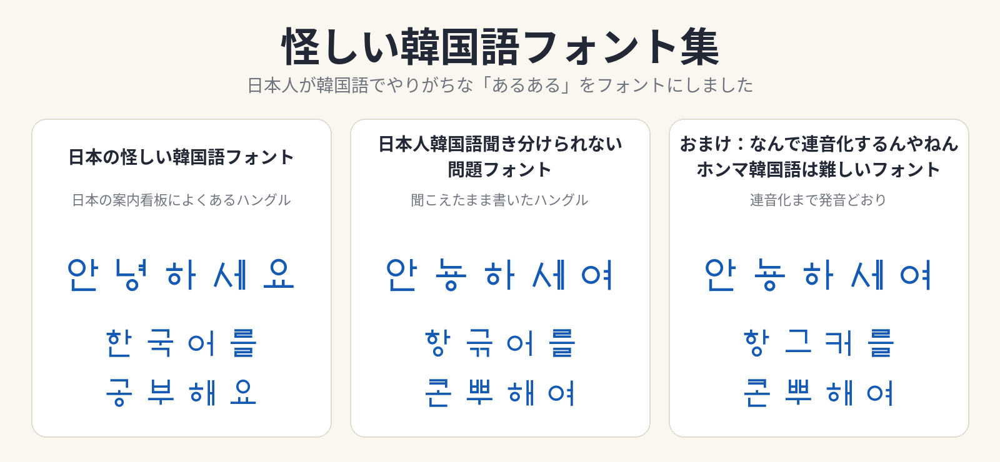
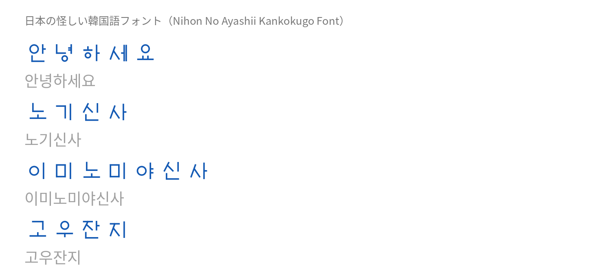
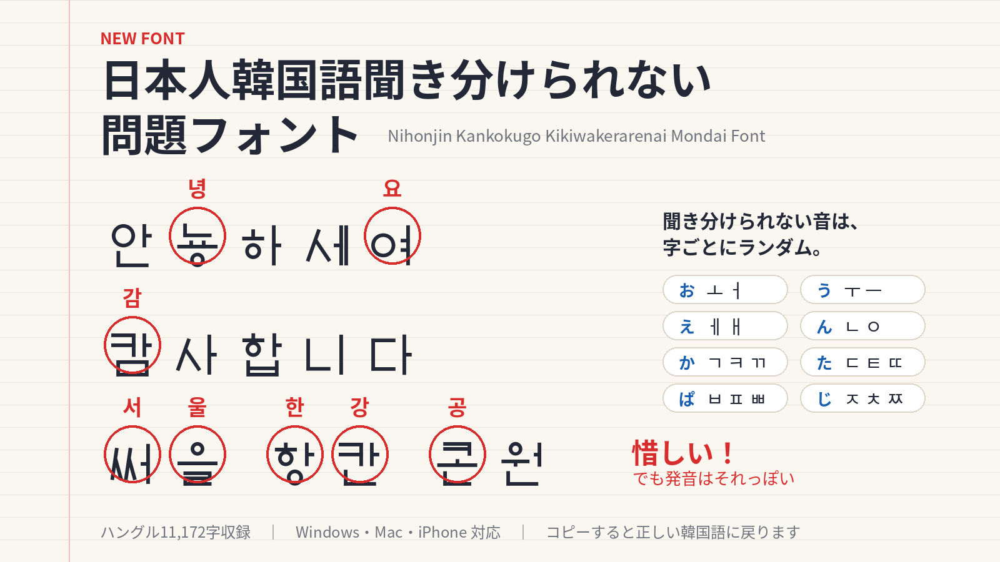
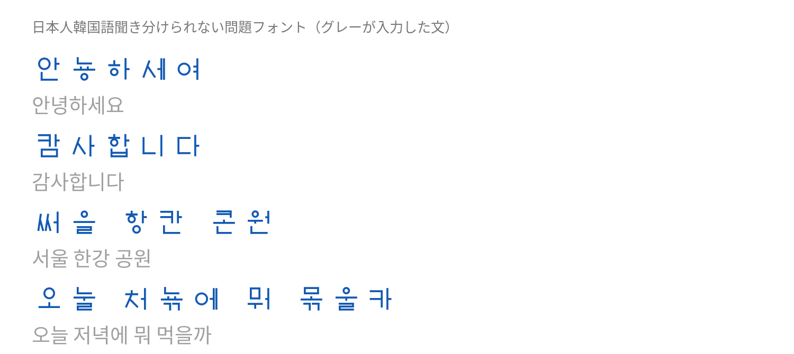
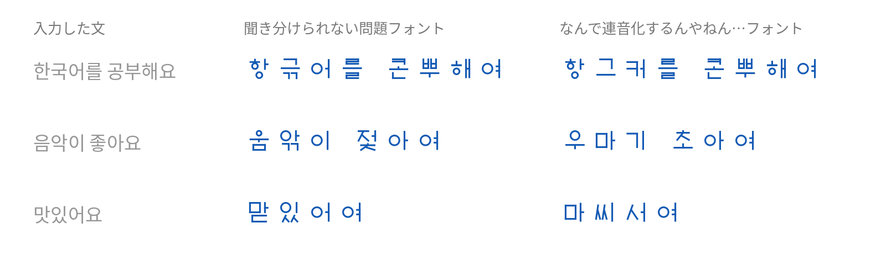
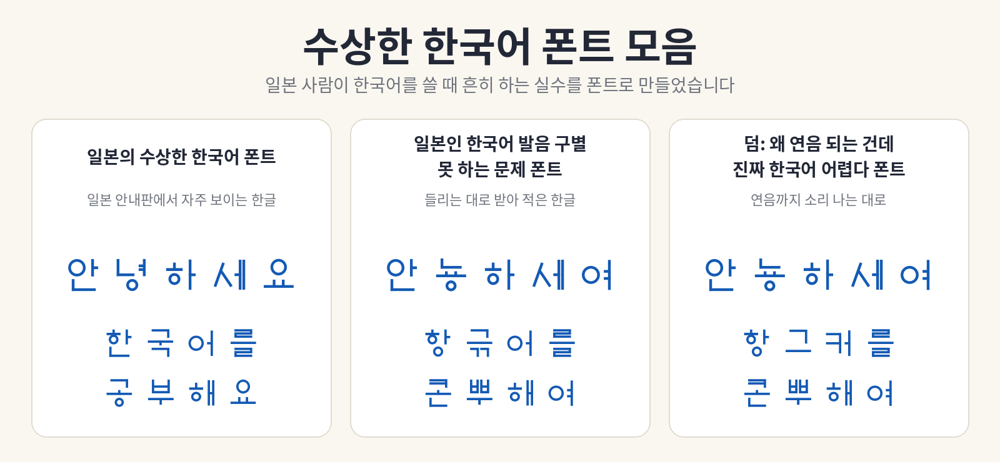
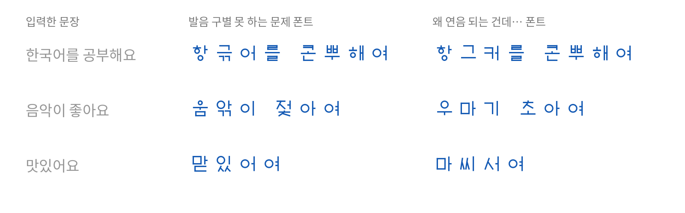

<p>
<a href="#怪しい韓国語フォント集"></a>
<a href="#수상한-한국어-폰트-모음"></a>
</p>

# 怪しい韓国語フォント集



日本人が韓国語でやりがちな「あるある」を、フォントにしました。

## ダウンロード

**[3つまとめてダウンロード（zip）](https://github.com/yukanosimi-tech/ayashii-hanguru-fonts/archive/refs/heads/main.zip)**　zip の中の `fonts` フォルダに Windows・Mac 用、`ios` フォルダに iPhone・iPad 用のファイルが入っています。

| フォント | Windows・Mac | iPhone・iPad |
|---|---|---|
| 日本の怪しい韓国語フォント | [.ttf](https://github.com/yukanosimi-tech/ayashii-hanguru-fonts/raw/main/fonts/NihonNoAyashiiKankokugoFont.ttf) | [プロファイル](https://github.com/yukanosimi-tech/ayashii-hanguru-fonts/raw/main/ios/NihonNoAyashiiKankokugoFont.mobileconfig) |
| 日本人韓国語聞き分けられない問題フォント | [.ttf](https://github.com/yukanosimi-tech/ayashii-hanguru-fonts/raw/main/fonts/NihonjinKankokugoKikiwakerarenaiMondaiFont.ttf) | [プロファイル](https://github.com/yukanosimi-tech/ayashii-hanguru-fonts/raw/main/ios/NihonjinKankokugoKikiwakerarenaiMondaiFont.mobileconfig) |
| おまけ：なんで連音化するんやねんホンマ韓国語は難しいフォント | [.ttf](https://github.com/yukanosimi-tech/ayashii-hanguru-fonts/raw/main/fonts/NandeRenonkaSurunyanenHonmaKankokugoWaMuzukashiiFont.ttf) | [プロファイル](https://github.com/yukanosimi-tech/ayashii-hanguru-fonts/raw/main/ios/NandeRenonkaSurunyanenHonmaKankokugoWaMuzukashiiFont.mobileconfig) |

どれもハングル11,172字（現代ハングル全部）と単独の字母を収録しています。英字・記号は入っていません。インストール方法は[こちら](#インストール)。

## 日本の怪しい韓国語フォント

英語名：Nihon No Ayashii Kankokugo Font

> **きっかけ**
> このフォントは、X に投稿された日本の案内看板の写真がきっかけで作りました。
> 元のポスト：[doga さんのポスト（X）](https://x.com/doga/status/2121138809165521035)



- 字がマスに対して小さく、字間が広い
- 字母のパーツは1種類だけで、置き場所に合わせて引き伸ばしているだけ
- 線は日本のゴシック体風の均一な太さ。ㅅ は「人」型、ㅇ は正円

## 日本人韓国語聞き分けられない問題フォント

英語名：Nihonjin Kankokugo Kikiwakerarenai Mondai Font



見た目は日本の怪しい韓国語フォントと同じで、そのうえで、日本人が聞き分けにくい字母を字ごとにランダムで入れ替えています。

| 音 | 入れ替わる字母 |
|---|---|
| お | ㅗ ㅓ |
| う | ㅜ ㅡ |
| え | ㅔ ㅐ |
| よ / いぇ / うぇ | ㅛ ㅕ ／ ㅖ ㅒ ／ ㅞ ㅙ ㅚ |
| か・た・ぱ・じ・さ行の子音 | ㄱ ㅋ ㄲ ／ ㄷ ㅌ ㄸ ／ ㅂ ㅍ ㅃ ／ ㅈ ㅊ ㅉ ／ ㅅ ㅆ |
| パッチムの「ん」 | ㄴ ㅇ |
| 同じ音になるパッチム | ㄱ ㅋ ㄲ ／ ㄷ ㅌ ㅅ ㅆ ㅈ ㅊ ㅎ |



入れ替えは字ごとに固定です（例えば「감」はどこでも同じ見た目になります）。見た目が変わるだけで、中身のデータは普通の韓国語なので、**コピーして別の場所に貼ると正しい韓国語に戻ります**。

## おまけ：なんで連音化するんやねんホンマ韓国語は難しいフォント

英語名：Nande Renonka Surunyanen Honma Kankokugo Wa Muzukashii Font

日本人韓国語聞き分けられない問題フォントに、連音化を発音どおりに表示する機能を足したものです。한국어 → 한구거、음악이 → 으마기、있어요 → 이써요、좋아요 → 조아요 のように、前後の字を見て表示を変えます。



連音化は OpenType の文脈置換（`calt` / `ccmp`）という機能を使っていて、**アプリによっては効きません**。

| 環境 | 連音化 |
|---|---|
| Mac・iPhone・iPad のアプリ（Pages、Keynote、テキストエディットなど） | 効く |
| Web ブラウザ（Chrome、Safari、Edge、Firefox） | 効く |
| Adobe のアプリ（Photoshop、Illustrator など） | 効く |
| Microsoft Office（Word など） | 初期設定では効かない場合がある。Word ではフォントの詳細設定の「コンテキスト代替」をオンにすると効くことがある |
| 古いアプリや、OpenType の機能に対応していないアプリ | 効かない |

効かない環境では、日本人韓国語聞き分けられない問題フォントと同じ表示になります。

## インストール

フォント名は、日本語の環境では日本語名、それ以外の環境では英語名でフォント一覧に表示されます。

### Windows
ダウンロードした `.ttf` ファイルを右クリックして「インストール」を選びます。

### Mac
`.ttf` ファイルをダブルクリックすると Font Book が開くので、「インストール」を押します。

### iPhone / iPad
[ダウンロード](#ダウンロード)の「プロファイル」のリンクを iPhone の Safari で開いてダウンロードし、「設定」→「プロファイルがダウンロードされました」から「インストール」を押します。うまく開かない場合は、「ファイル」アプリのダウンロードフォルダからファイルを開いてください。

- 「未検証」と表示されますが、署名していない自作のプロファイルのためです。中身はフォントだけです。
- プロファイルは必ずこのリポジトリからダウンロードしてください。インストール画面の内容が「フォント」だけであることを確認し、証明書・VPN・制限など別の項目が含まれていたらインストールしないでください。
- Pages や Keynote など、フォントを選べるアプリで使えます。iPhone 全体の表示フォントは変わりません。
- 削除は「設定」→「一般」→「VPNとデバイス管理」から行えます。

### Android
本体のフォント変更は機種によるため、Phonto など `.ttf` を読み込める画像編集アプリで使うのが手軽です。

## 注意点

- フォントは自分の画面での見た目を変えるだけです。LINE や SNS で文字を送っても、相手には普通のフォントで表示されます。この見た目を見せたいときは画像にしてください。
- 連音化はアプリによって効かないことがあります（上の「おまけ」の表を参照）。

## 作り直し方

フォントはすべて Python のスクリプトで、字母のパーツから自動生成しています。

```sh
pip install fonttools
sh src/build.sh
```

| ファイル | 役割 |
|---|---|
| `src/make_font.py` | 字母のパーツ定義と、組み合わせて音節を作る本体（日本の怪しい韓国語フォント） |
| `src/make_mimi.py` | 字母のランダム入れ替え（日本人韓国語聞き分けられない問題フォント） |
| `src/add_liaison.py` | 連音化の OpenType 機能を追加（なんで連音化するんやねんホンマ韓国語は難しいフォント） |
| `src/make_mobileconfig.py` | iPhone / iPad 用プロファイルの作成 |

## ライセンス

- フォント（`fonts/`、`ios/`）: [SIL Open Font License 1.1](OFL.txt)
- スクリプト（`src/`）: [MIT License](LICENSE-code.txt)

フォントは自由に使用・改変・再配布できます（フォント単体での販売は不可）。

---

<p>
<a href="#怪しい韓国語フォント集"></a>
<a href="#수상한-한국어-폰트-모음"></a>
</p>

# 수상한 한국어 폰트 모음



일본 사람이 한국어를 쓸 때 흔히 하는 실수를 폰트로 만들었습니다.

## 다운로드

**[3종 한꺼번에 다운로드(zip)](https://github.com/yukanosimi-tech/ayashii-hanguru-fonts/archive/refs/heads/main.zip)**　zip 안의 `fonts` 폴더에 Windows·Mac용, `ios` 폴더에 iPhone·iPad용 파일이 들어 있습니다.

| 폰트 | Windows·Mac | iPhone·iPad |
|---|---|---|
| 일본의 수상한 한국어 폰트 | [.ttf](https://github.com/yukanosimi-tech/ayashii-hanguru-fonts/raw/main/fonts/NihonNoAyashiiKankokugoFont.ttf) | [프로파일](https://github.com/yukanosimi-tech/ayashii-hanguru-fonts/raw/main/ios/NihonNoAyashiiKankokugoFont.mobileconfig) |
| 일본인 한국어 발음 구별 못 하는 문제 폰트 | [.ttf](https://github.com/yukanosimi-tech/ayashii-hanguru-fonts/raw/main/fonts/NihonjinKankokugoKikiwakerarenaiMondaiFont.ttf) | [프로파일](https://github.com/yukanosimi-tech/ayashii-hanguru-fonts/raw/main/ios/NihonjinKankokugoKikiwakerarenaiMondaiFont.mobileconfig) |
| 덤: 왜 연음 되는 건데 진짜 한국어 어렵다 폰트 | [.ttf](https://github.com/yukanosimi-tech/ayashii-hanguru-fonts/raw/main/fonts/NandeRenonkaSurunyanenHonmaKankokugoWaMuzukashiiFont.ttf) | [프로파일](https://github.com/yukanosimi-tech/ayashii-hanguru-fonts/raw/main/ios/NandeRenonkaSurunyanenHonmaKankokugoWaMuzukashiiFont.mobileconfig) |

모든 폰트에 현대 한글 11,172자 전부와 낱자모를 수록하고 있습니다. 영문과 기호는 들어 있지 않습니다. 설치 방법은 [여기](#설치-방법)를 보세요.

## 일본의 수상한 한국어 폰트

원래 이름: 日本の怪しい韓国語フォント (Nihon No Ayashii Kankokugo Font)

> **계기**
> 이 폰트는 X에 올라온 일본 안내판 사진을 계기로 만들었습니다.
> 원래 게시물: [doga 님의 게시물(X)](https://x.com/doga/status/2121138809165521035)


일본 관광지 안내판 등에서 자주 보이는 한글을 재현했습니다.

- 글자가 칸에 비해 작고 자간이 넓습니다
- 자모마다 모양이 한 가지뿐이고, 들어갈 자리에 맞춰 늘이기만 했습니다
- 획은 일본 고딕체처럼 굵기가 일정합니다. ㅅ은 '人' 모양, ㅇ은 완전한 원입니다

## 일본인 한국어 발음 구별 못 하는 문제 폰트

원래 이름: 日本人韓国語聞き分けられない問題フォント (Nihonjin Kankokugo Kikiwakerarenai Mondai Font)


겉모양은 '일본의 수상한 한국어 폰트'와 같고, 여기에 일본 사람이 구별하기 어려운 자모를 글자마다 무작위로 바꾸는 "잘못 듣기"가 더해집니다. 일본어에는 없는 구별이라서, 일본 사람 귀에는 같은 소리로 들리기 쉬운 자모들입니다.

| 일본어로는 같은 소리 | 바뀌는 자모 |
|---|---|
| お (오) | ㅗ ㅓ |
| う (우) | ㅜ ㅡ |
| え (에) | ㅔ ㅐ |
| よ / いぇ / うぇ (요 / 예 / 웨) | ㅛ ㅕ ／ ㅖ ㅒ ／ ㅞ ㅙ ㅚ |
| 평음·격음·경음 | ㄱ ㅋ ㄲ ／ ㄷ ㅌ ㄸ ／ ㅂ ㅍ ㅃ ／ ㅈ ㅊ ㅉ ／ ㅅ ㅆ |
| 받침 'ん' (응) | ㄴ ㅇ |
| 같은 소리가 나는 받침 | ㄱ ㅋ ㄲ ／ ㄷ ㅌ ㅅ ㅆ ㅈ ㅊ ㅎ |


자모 교체는 글자마다 고정입니다(예를 들어 '감'은 어디에 나와도 같은 모양). 바뀌는 것은 겉모양뿐이고 데이터는 평범한 한국어이므로, **복사해서 다른 곳에 붙여 넣으면 올바른 한국어로 돌아옵니다**.

## 덤: 왜 연음 되는 건데 진짜 한국어 어렵다 폰트

원래 이름: なんで連音化するんやねんホンマ韓国語は難しいフォント (Nande Renonka Surunyanen Honma Kankokugo Wa Muzukashii Font)

원래 이름은 간사이 사투리로 "왜 연음이 되는 건데, 진짜 한국어는 어렵다"라는 뜻입니다. '일본인 한국어 발음 구별 못 하는 문제 폰트'에 연음을 소리 나는 대로 표시하는 기능을 더한 것입니다. 한국어 → 한구거, 음악이 → 으마기, 있어요 → 이써요, 좋아요 → 조아요처럼 앞뒤 글자를 보고 표시를 바꿉니다.



연음 기능은 OpenType 문맥 대체(`calt` / `ccmp`)를 사용하기 때문에 **앱에 따라서는 작동하지 않습니다**.

| 환경 | 연음 |
|---|---|
| Mac·iPhone·iPad 앱(Pages, Keynote, 텍스트 편집기 등) | 작동함 |
| 웹 브라우저(Chrome, Safari, Edge, Firefox) | 작동함 |
| Adobe 앱(Photoshop, Illustrator 등) | 작동함 |
| Microsoft Office(Word 등) | 기본 설정에서는 작동하지 않을 수 있음. Word에서는 글꼴 고급 설정의 문맥 대체(Contextual Alternates) 옵션을 켜면 작동할 수 있음 |
| 오래된 앱이나 OpenType 기능을 지원하지 않는 앱 | 작동하지 않음 |

작동하지 않는 환경에서는 '일본인 한국어 발음 구별 못 하는 문제 폰트'과 같은 모양으로 표시됩니다.

## 설치 방법

폰트 목록에는 일본어 환경에서는 일본어 이름으로, 그 밖의 환경(한국어 포함)에서는 영어 이름으로 표시됩니다.

### Windows
내려받은 `.ttf` 파일을 마우스 오른쪽 버튼으로 클릭하고 "설치"를 선택합니다.

### Mac
`.ttf` 파일을 더블클릭하면 서체 관리자(Font Book)가 열리니 "설치"를 누릅니다.

### iPhone / iPad
[다운로드](#다운로드)의 "프로파일" 링크를 iPhone의 Safari에서 열어 다운로드한 다음, "설정" 앱 상단의 "프로파일이 다운로드됨"에서 "설치"를 누릅니다. 잘 열리지 않으면 "파일" 앱의 다운로드 폴더에서 파일을 여세요.

- "확인되지 않음"이라고 표시되는 것은 서명하지 않은 프로파일이기 때문입니다. 안에는 폰트만 들어 있습니다.
- 프로파일은 반드시 이 저장소에서 내려받으세요. 설치 화면의 내용이 "서체"뿐인지 확인하고, 인증서·VPN·제한 등 다른 항목이 들어 있다면 설치하지 마세요.
- Pages, Keynote 등 폰트를 고를 수 있는 앱에서 쓸 수 있습니다. iPhone 전체의 표시 폰트는 바뀌지 않습니다.
- 삭제는 "설정" → "일반" → "VPN 및 기기 관리"에서 할 수 있습니다.

### Android
기기 자체의 폰트 변경은 기종마다 다르므로, Phonto처럼 `.ttf` 파일을 불러올 수 있는 이미지 편집 앱에서 쓰는 것이 간편합니다.

## 참고 사항

- 폰트는 자기 화면에서의 모양만 바꿉니다. 카카오톡이나 SNS로 글을 보내도 상대방에게는 평소 폰트로 보입니다. 이 모양을 보여 주고 싶다면 이미지로 만들어 주세요.
- 연음 기능은 앱에 따라 작동하지 않을 수 있습니다(위의 '덤' 항목의 표 참고).

## 다시 만들기

폰트는 모두 Python 스크립트로 자모 부품을 조합해 자동 생성합니다.

```sh
pip install fonttools
sh src/build.sh
```

| 파일 | 역할 |
|---|---|
| `src/make_font.py` | 자모 부품 정의와 음절 조합 본체(일본의 수상한 한국어 폰트) |
| `src/make_mimi.py` | 자모 무작위 교체(일본인 한국어 발음 구별 못 하는 문제 폰트) |
| `src/add_liaison.py` | 연음 OpenType 기능 추가(왜 연음 되는 건데 진짜 한국어 어렵다 폰트) |
| `src/make_mobileconfig.py` | iPhone / iPad용 프로파일 생성 |

## 라이선스

- 폰트(`fonts/`, `ios/`): [SIL Open Font License 1.1](OFL.txt)
- 스크립트(`src/`): [MIT License](LICENSE-code.txt)

폰트는 자유롭게 사용, 수정, 재배포할 수 있습니다(폰트 단독 판매는 불가).
